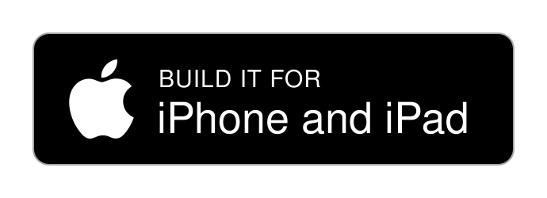
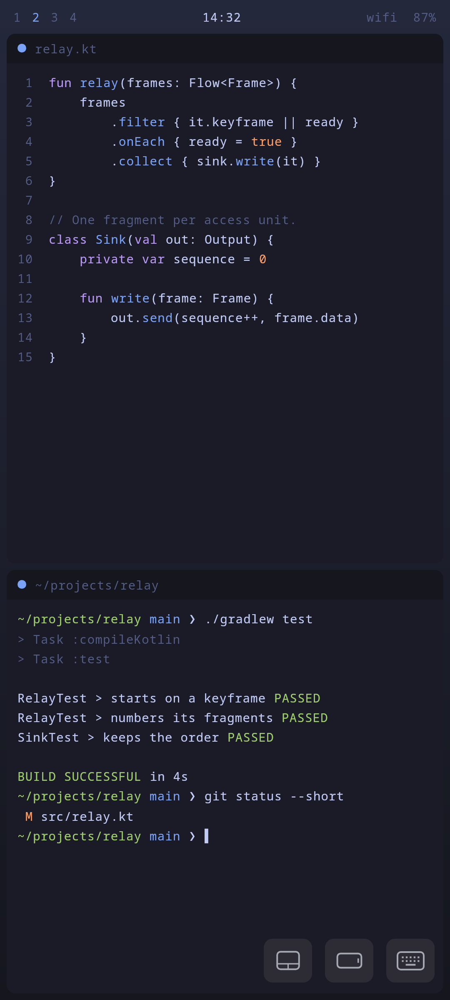
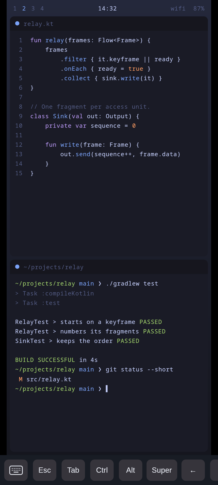
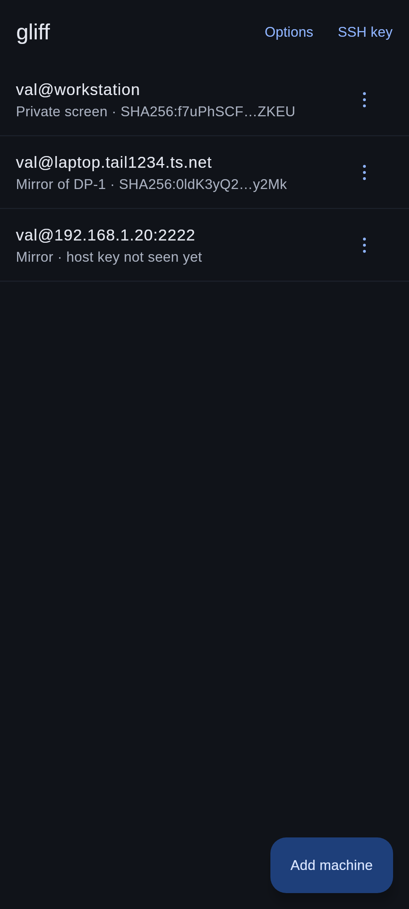
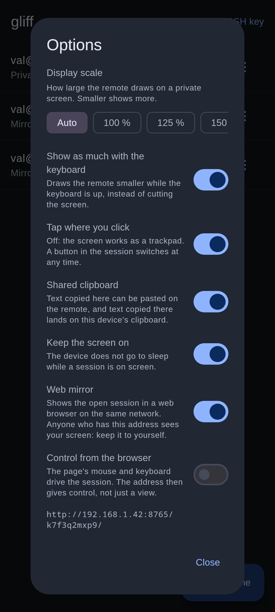

# Gliff Client

A mobile client for [gliff](https://github.com/omacom/gliff), the Hyprland
remote desktop over SSH: an Android app, and an iPhone and iPad app built
from the same code. It talks to an unmodified `gliff-server`.

<p align="center">
  <a href="https://play.google.com/store/apps/details?id=io.github.c4software.gliff"></a>
  <a href="#build-iphone-and-ipad"></a>
</p>

<p align="center">
  
  
  
  
</p>

This project is not affiliated with the gliff authors.

The code is Kotlin Multiplatform. The protocol, the session, the input
mapping and the screens (Compose Multiplatform) are written once; each
platform adds its ssh client, its video decoder, its keyboard and its
storage.

## Status

| | Android | iPhone and iPad |
|---|---|---|
| State | Works, in daily use | Written, compiles, **not run on a device yet** |
| ssh | sshj | swift-nio-ssh, tested against a real `sshd` |
| Video | `MediaCodec` | VideoToolbox |
| Build | Gradle | xtool, from Linux, no Mac |

What the client does:

- **Machines**: saved machines (`user@host` or `user@host:port`), host keys
  trusted on first use, and an Ed25519 key generated by the app. On Android, a
  long press on the launcher's icon lists them, to open one directly.
- **Video**: H.264, decoded by the device's hardware.
- **Screens**: a private (headless) screen sized to the window, or the mirror
  of an output.
- **Windows**: resizable windows, one per machine in desktop mode (Android)
  or on an iPad.
- **Pointer**: touch as direct touch or as a trackpad, pinch to zoom and
  two-finger pan on the client side, physical mouse.
- **Keyboard**: on-screen keyboard with a row of extra keys, and physical
  keyboards. Typing uses the remote's own keyboard layout, read over ssh with
  `hyprctl` and `xkbcli`.
- **Clipboard**: text shared both ways.
- **Options**: resolution (the window's, a usual one or any other, for all machines or for one), keyboard zoom, touch mode, shared clipboard,
  keep screen on.
- **Web mirror** (Android only): an HTTP server on port 8765 that shows the
  session in a browser as fragmented MP4 through Media Source, optionally
  with mouse and keyboard control. While a browser watches, the remote is
  sized for the browser's window and zoom rather than for the device, whose
  screen can go black meanwhile. The page sits behind a random token in the
  URL. Off by default.

Not done yet:

- the iOS app on a real device: everything above is written for it, none of
  it has been seen running;
- automatic reconnection (and, on Android, a foreground service): a session
  is lost when the system suspends the app in the background;
- images and files in the clipboard;
- dead keys;
- the remote cursor shape;
- AVC444 (`Dual420`).

## Requirements

The remote machine needs `gliff-server` and a running Hyprland session. With
Tailscale SSH nothing else is needed. Otherwise, add the app's key to
`~/.ssh/authorized_keys` on the remote: in the app, "SSH key" shows the line
to add. Then "Add machine" (`user@host`); the first connection shows the host
key fingerprint to confirm.

## Layout

| Path | Content |
|---|---|
| `proto` | CBOR, messages and framing. Pure Kotlin, no dependency. |
| `domain` | What the client decides: machines, options, input mapping, geometry, clipboard exchange, and the contracts the other layers implement. Pure Kotlin, on every platform. |
| `transport` | `Session` (handshake, read and write loops), the ssh command line and key formats. On JVM and Android: ssh (sshj), the web mirror server, the `probe` CLI and a fake server for tests. |
| `shared` | `data` (storage, sessions, decoders), `di` (Koin modules) and `presentation` (ViewModels and Compose Multiplatform screens), with the Android implementations (`MediaCodec`, video surface, storage, web mirror) and the iOS ones (VideoToolbox, keyboard, clipboard, the app's entry point). |
| `app` | The Android application: activities and manifest. |
| `iosApp` | The iOS and iPadOS application: a SwiftUI host, the keychain, and `GliffSSH`, the ssh client. |

`shared` also has a `desktop` target, which exists only for tests: it runs
the logic and renders the screens off-device into `shared/build/screenshots`.

How the layers depend on each other, and why: [ARCHITECTURE.md](ARCHITECTURE.md).

## Build: Android

```sh
./gradlew :app:assembleDebug
adb install -r app/build/outputs/apk/debug/app-debug.apk
```

## Build: iPhone and iPad

The iOS app is not on the App Store or TestFlight: to use it, build it and
install it on your own device. Remember that it has not been run on a device
yet (see [Status](#status)).

There is no Xcode project: `iosApp` is an [xtool](https://xtool.sh) project,
built and installed from Linux (or WSL). There is no simulator outside a Mac,
so it goes to a real iPhone or iPad, iOS 17 or later, over USB.

### With the script

```sh
scripts/build-ios.sh
```

Have ready:

- the Swift toolchain (the version
  [xtool's guide](https://xtool.sh/documentation/xtooldocs/installation-linux)
  names), from [swift.org](https://swift.org/install/linux): the script
  cannot install it;
- an Apple account, and `Xcode.xip` downloaded in a browser from
  [developer.apple.com](https://developer.apple.com/download/all/?q=Xcode)
  (several GB), for the first run;
- [`gh`](https://cli.github.com) and a GitHub account;
- the device and a USB cable.

The script then does the following, asking along the way:

1. It checks the tools, offers to install `usbmuxd` (pacman or apt) and xtool
   (into `~/.local/bin`), logs `gh` in, and runs `xtool setup` when the iOS
   SDK is missing.
2. It asks for a bundle ID of your Apple account, and keeps it in
   `iosApp/.bundle-id` (not versioned; delete it to choose again).
3. It gets `Shared.xcframework` for the current commit: the one already
   there, the one GitHub is building, or, when none exists, it offers to push
   a tag `ios-build-<commit>` to `origin` to build one, or to take the last
   one built.
4. It runs `xtool dev`, and offers to run it again when it stops, which it
   often does the first time a device is used.

Run it again after a change, or every 7 days with a free Apple account: the
steps already done are skipped, so it only rebuilds and reinstalls.

<details>
<summary><b>By hand</b>: the same steps, without the script</summary>

#### 1. Tools, once

Following [xtool's guide](https://xtool.sh/documentation/xtooldocs/installation-linux):

- the Swift toolchain (the version xtool's guide names), from
  [swift.org](https://swift.org/install/linux);
- `usbmuxd`, to reach the device over USB (on Arch, `pacman -S usbmuxd`);
- `Xcode.xip`, downloaded in a browser from
  [developer.apple.com](https://developer.apple.com/download/all/?q=Xcode)
  with an Apple account;
- xtool itself, an AppImage:

  ```sh
  curl -fL "https://github.com/xtool-org/xtool/releases/latest/download/xtool-$(uname -m).AppImage" -o xtool
  chmod +x xtool && sudo mv xtool /usr/local/bin/
  ```

- the `gh` command, logged in (`gh auth login`), to fetch the framework below.

Then:

```sh
xtool setup      # logs in to Apple, then asks for the path to Xcode.xip
swift sdk list   # should list darwin
```

At login, "API Key" needs a paid Apple Developer Program membership;
"Password" works with any Apple account, through private Apple APIs. With a
free account, the app stops opening after 7 days: run `xtool dev` again to
sign it anew.

#### 2. Bundle ID

An app ID belongs to one Apple account: `io.github.c4software.gliff` is
taken. Put one of yours in `iosApp/xtool.yml`, for example:

```yaml
bundleID: com.example.gliff
```

#### 3. The Kotlin framework

The Kotlin side reaches the app as `Shared.xcframework`, which is not in the
repository. Kotlin compiles the iOS targets anywhere but only links a
framework on a Mac, so that step runs on GitHub
(`.github/workflows/ios-framework.yml`, a macOS runner, about 25 minutes),
on any tag that starts with `ios-`:

```sh
git tag ios-try-1 && git push origin ios-try-1
scripts/fetch-ios-framework.sh   # the last successful run, into iosApp/Frameworks
```

The framework has to come from the same commit as the Swift sources: the
script prints the commit it took. From a fork, enable Actions on the fork,
push the tag there, and point `gh` at it first (`gh repo set-default`).

On a Mac, the framework can be linked locally instead:
`./gradlew :shared:assembleSharedReleaseXCFramework`, then copy
`shared/build/XCFrameworks/release/Shared.xcframework` to `iosApp/Frameworks`.

#### 4. Build and install

Plug the device in over USB, then:

```sh
cd iosApp
xtool dev        # builds, signs, installs and launches
```

The first build takes a few minutes. The first time a device is used:

- tap **Trust** on the device and enter its passcode; if `xtool dev` then
  stops with an error, run it again;
- if it asks for **Developer Mode**, turn it on in Settings > Privacy &
  Security > Developer Mode (the device restarts), then run `xtool dev` again;
- with a free account, the first launch says "Untrusted Developer": allow it
  in Settings > General > VPN & Device Management, under your Apple account.

`xtool dev` again rebuilds and reinstalls after a change.

</details>

## Tests

```sh
./gradlew :proto:jvmTest :domain:jvmTest :transport:jvmTest :shared:desktopTest
./gradlew :shared:compileKotlinIosArm64      # the iOS sources compile
swift test --package-path iosApp/GliffSSH    # the iOS ssh client
```

`SshTest` and the Swift tests each start a temporary local `sshd`; they are
skipped if `sshd` is not installed. Nothing of the iOS app's screens is
tested automatically: without a simulator, that takes a device.

A test against a real server runs only when one is named:

```sh
GLIFF_REAL=user@host ./gradlew :shared:desktopTest --tests '*RealServerTest*'
```

It goes through the system's `ssh`, so the host has to accept it without a
prompt.

## Probe (no device needed)

```sh
./gradlew :transport:probe --args="user@host --headless 1280x720"
ffplay out.h264
```

`probe` connects to a gliff server and dumps its H.264 stream to a file.
`--help` lists the options. The default key is `~/.ssh/id_ed25519`, and the
host key must be in `~/.ssh/known_hosts` (or pass `--accept-new`).

## Fake server (no Hyprland needed)

```sh
scripts/make-sample.sh                      # encodes a test stream (ffmpeg)
./gradlew :transport:toolsClasspath
./gradlew :transport:probe --args="--exec $PWD/scripts/fake-server.sh --seconds 5"
```

`scripts/fake-server.sh` speaks the protocol on stdio and replays the stream
in a loop; it can also be used as `--server-bin` through SSH.

## Protocol reference

`vendor/gliff` (not versioned) holds a clone of gliff, the reference for the
protocol; `docs/protocol-notes.md` sums up what was found there.

## Release builds (Android)

The version is the git tag: `android-v1.2.3` gives `versionName` 1.2.3 and
`versionCode` 1002003; any other commit is named after `git describe`.

A release build is signed when it is given a keystore, and comes out unsigned
otherwise. The keystore is described by the environment (`RELEASE_KEYSTORE`,
a path, `RELEASE_KEYSTORE_PASSWORD`, `RELEASE_KEY_ALIAS`,
`RELEASE_KEY_PASSWORD`), or by a properties file (`storeFile`,
`storePassword`, `keyAlias`, `keyPassword`) that a `release.signing=` line of
`local.properties` points to. Neither belongs in the repository.

```sh
./gradlew :app:assembleRelease   # APK
./gradlew :app:bundleRelease     # AAB, for the Play Store
```

On GitHub, `.github/workflows/release.yml` does it on an `android-v*` tag, or by hand:
tests, signed APK and bundle, a check of the signature and of the version, a
GitHub release, and the bundle sent to internal testing on the Play Store
when a `PLAY_SERVICE_ACCOUNT_JSON` secret exists. It reads the keystore from
the secrets `RELEASE_KEYSTORE_BASE64` (`base64 -w0` of the file),
`RELEASE_KEYSTORE_PASSWORD`, `RELEASE_KEY_ALIAS` and `RELEASE_KEY_PASSWORD`.
`ci.yml` runs the tests on pull requests.

The iOS app has no release build yet: it goes from the dev machine to a
device with `xtool dev`.

## License

Released under the MIT license, like gliff itself. See `LICENSE`.
